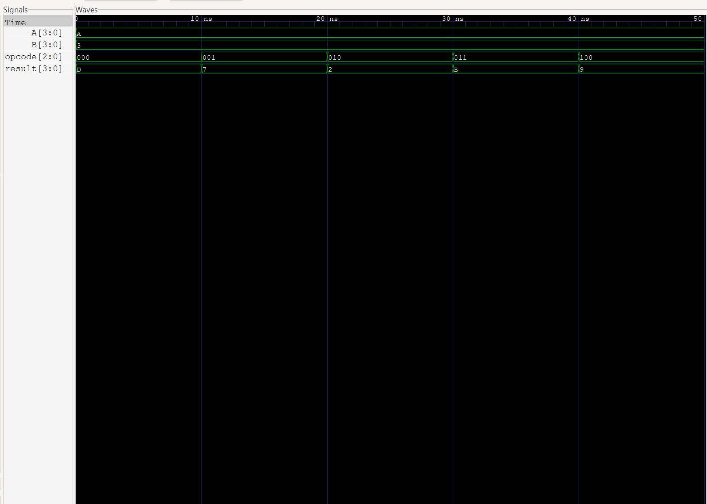

# 4-Bit ALU Using Verilog HDL

A 4-bit Arithmetic Logic Unit (ALU) designed using Verilog HDL and verified through simulation with Icarus Verilog and GTKWave.

## Features

The ALU supports five operations selected using a 3-bit opcode.

| Opcode | Operation | Description |
|---|---|---|
| `000` | ADD | A + B |
| `001` | SUB | A - B |
| `010` | AND | Bitwise AND |
| `011` | OR | Bitwise OR |
| `100` | XOR | Bitwise XOR |

## Project Files

- `alu.v` — Verilog implementation of the ALU.
- `alu_tb.v` — Testbench used to verify the operations.
- `waveform.vcd` — Waveform data generated during simulation.

## Simulation Results

Test inputs: A = 10, B = 3.

| Operation | Expected Result | Simulated Result |
|---|---:|---:|
| ADD | 13 | 13 |
| SUB | 7 | 7 |
| AND | 2 | 2 |
| OR | 11 | 11 |
| XOR | 9 | 9 |

## Tools Used

- Verilog HDL
- Icarus Verilog
- GTKWave
- Visual Studio Code
## Simulation Waveform

The waveform below shows the ALU outputs for all five operations.

## Learning Outcomes

- Practiced combinational logic design using Verilog.
- Used a `case` statement to select operations.
- Created a testbench to verify hardware functionality.
- Examined simulation waveforms using GTKWave.
